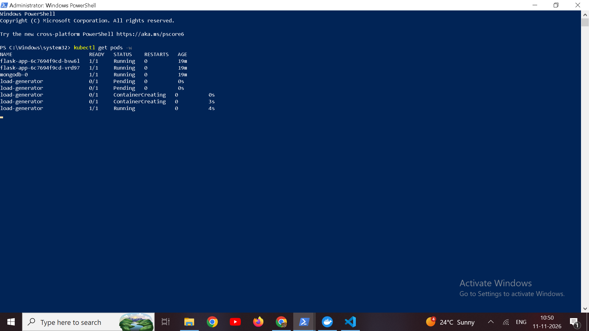
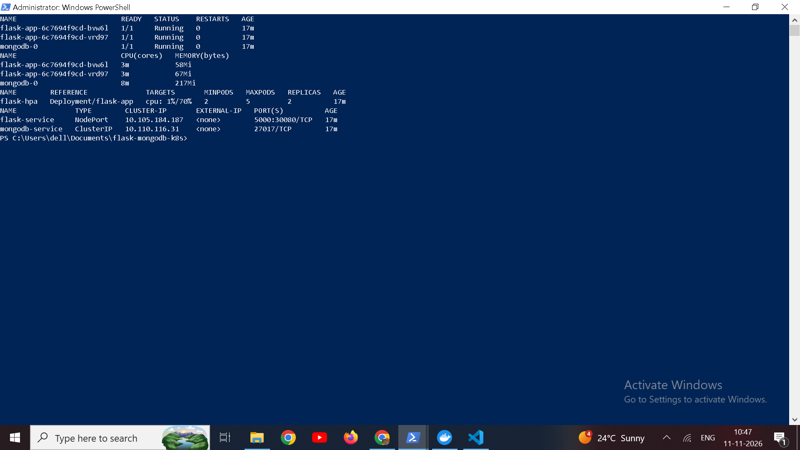
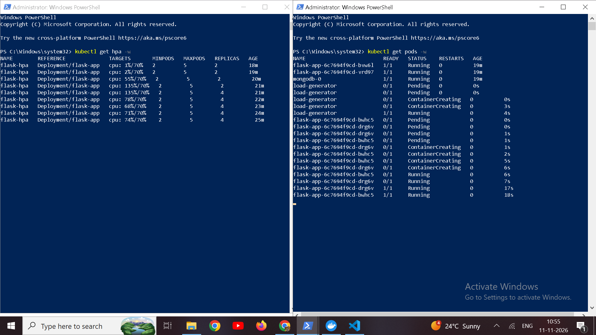
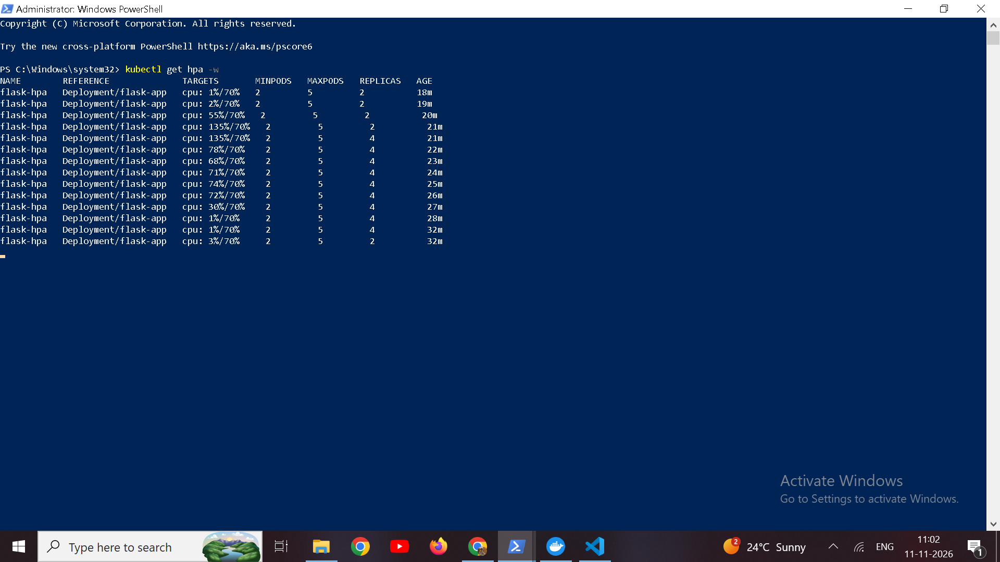
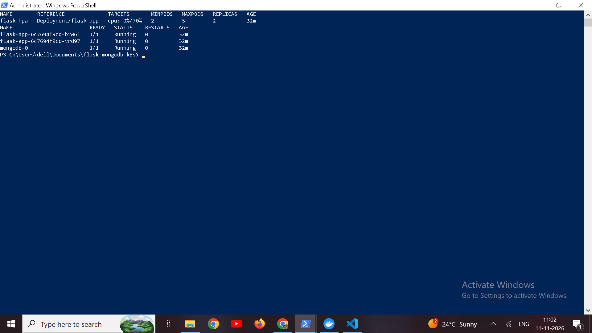
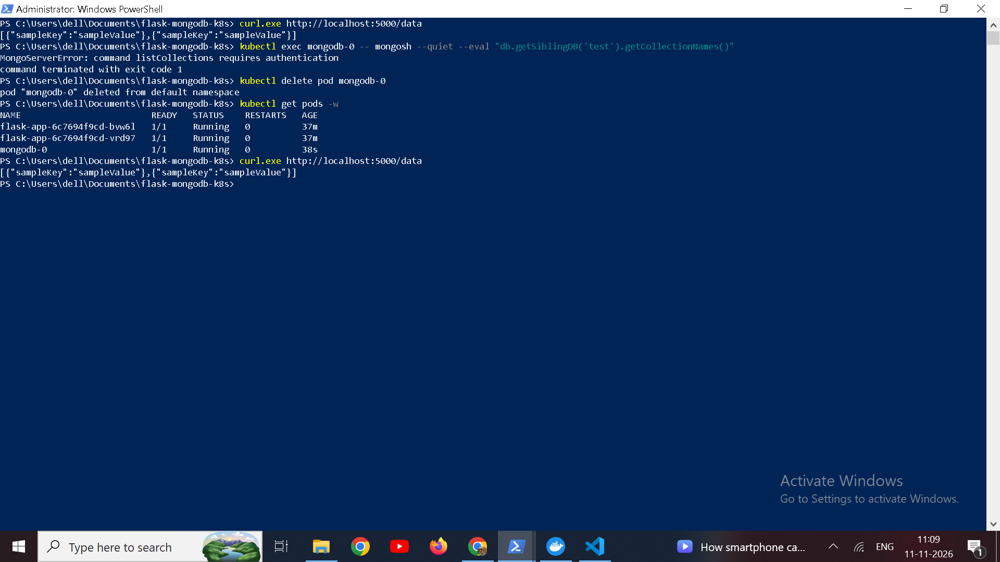
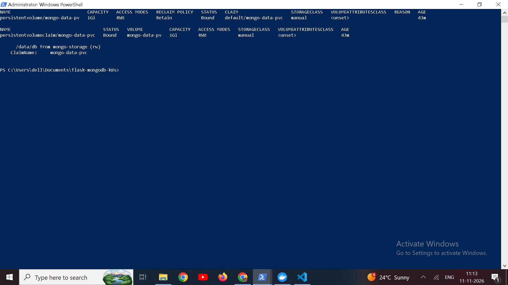

# Flask + MongoDB on Kubernetes

A Flask app that stores JSON in MongoDB, running on Minikube. MongoDB needs a login and keeps its data on a persistent volume. The Flask pods scale between 2 and 5 replicas based on CPU.

Docker image: `anubhav9098/flask-mongodb-app:v2`

## Files

- `app.py`, `requirements.txt`, `Dockerfile`: the app and its image
- `k8s/`: YAML for every resource, applied in file name order
- `tests/`: `smoke-test.ps1` for quick checks and `load-generator.yaml` for the autoscaling test
- `screenshots/`: the results shown in the Testing section

## Changes to app.py

The assignment version connects to MongoDB without a login. Mine reads `MONGO_HOST`, `MONGO_PORT`, `MONGO_USERNAME` and `MONGO_PASSWORD` from environment variables, and in Kubernetes the username and password come from a Secret. `authSource="admin"` is needed because the official MongoDB image creates the root user in the `admin` database. If `MONGODB_URI` is set it is used instead, so the local setup from Part 1 still works.

I also added `/healthz` and `/ready` for the Kubernetes probes. `POST /data` returns 400 for a body that is not a JSON object, and 503 if MongoDB cannot be reached.

## Part 1: run it locally

Needs Python 3.8 or newer, pip and Docker.

```bash
python3 -m venv venv
source venv/bin/activate          # Windows: venv\Scripts\activate
pip install -r requirements.txt
docker run -d -p 27017:27017 --name mongodb mongo:latest
cp .env.example .env              # Windows: copy .env.example .env
export $(cat .env | xargs)        # Windows PowerShell: $env:MONGODB_URI = "mongodb://localhost:27017/"
flask run
```

The app is on http://localhost:5000. Try the requests from the assignment:

```bash
curl http://localhost:5000/
curl -X POST -H "Content-Type: application/json" -d '{"sampleKey":"sampleValue"}' http://localhost:5000/data
curl http://localhost:5000/data
```

## Part 2: deploy on Minikube

Needs Docker, kubectl, Minikube and a Docker Hub account.

### 1. Build and push the image

```bash
docker build -t anubhav9098/flask-mongodb-app:v2 .
docker login
docker push anubhav9098/flask-mongodb-app:v2
```

To use another account, change the name here and in the `image:` line of `k8s/05-flask-deployment.yaml`. The repository must be public so the cluster can pull it.

### 2. Start Minikube

```bash
minikube start --driver=docker --cpus=2 --memory=1800
minikube addons enable metrics-server
```

The autoscaler cannot read CPU without metrics-server.

### 3. Deploy

```bash
kubectl apply -f k8s/
kubectl get pods,svc,pv,pvc,hpa
```

Wait until `mongodb-0` and both `flask-app` pods show `1/1 Running`. The Flask pods stay at `0/1` until MongoDB is up, because their readiness probe checks the database. The password in `k8s/01-mongo-secret.yaml` is only for local testing. Use letters and numbers, an `@` in it broke the connection URI.

### 4. Open the app

With the Docker driver on Windows I could not reach the NodePort directly, so I used a port-forward and left that terminal open:

```bash
kubectl port-forward svc/flask-service 5000:5000
```

Then use the same curl commands as in Part 1. In PowerShell use `curl.exe` and put the JSON in a file, because PowerShell breaks the quotes:

```powershell
'{"sampleKey":"sampleValue"}' | Out-File -Encoding ascii body.json
curl.exe -X POST -H "Content-Type: application/json" -d "@body.json" http://localhost:5000/data
```

## How DNS works inside the cluster

Kubernetes runs CoreDNS as the cluster DNS server. Every pod's `/etc/resolv.conf` points to it and has search domains like `default.svc.cluster.local`. Each Service gets the name `<service>.<namespace>.svc.cluster.local`, so mine is `mongodb-service.default.svc.cluster.local`. Because of the search domains, a pod in the same namespace can just use `mongodb-service`.

When Flask connects to the database:

1. The Deployment sets `MONGO_HOST=mongodb-service` in the Flask pod.
2. The pod asks CoreDNS for `mongodb-service`.
3. CoreDNS answers with the ClusterIP of the Service.
4. kube-proxy sends the traffic to the `mongodb-0` pod on port 27017.

Pod IPs change when a pod is recreated, but the Service name and ClusterIP stay the same, so the app always uses the name. The connection is configured in the Deployment like this, with the login taken from the Secret:

```yaml
env:
  - name: MONGO_HOST
    value: mongodb-service
  - name: MONGO_PORT
    value: "27017"
  - name: MONGO_USERNAME
    valueFrom:
      secretKeyRef:
        name: mongo-auth
        key: DB_USER
```

## Resource requests and limits

A request is the CPU and memory the scheduler reserves for a container. A pod only goes to a node that still has that much free. The autoscaler also works from the request, so "70% CPU" means 70% of the requested CPU, not of the limit.

A limit is the most a container can use. Above its CPU limit it is throttled. Above its memory limit it is killed (OOMKilled) and restarted.

Together they stop one workload from starving the others and help the scheduler place pods. I used the values from the assignment for both Flask and MongoDB: request 0.2 CPU and 250M, limit 0.5 CPU and 500M. With a 200m request the autoscaler adds pods when the average CPU per pod goes above 140m.

## Design choices

- MongoDB authentication: the root user variables plus the `--auth` flag. The official image creates the user on first start. An init script with a limited app user would be better for production but adds more setup.
- Credentials are in a Secret and passed as environment variables, so they are not in the image or the Deployment.
- MongoDB is a StatefulSet with 1 replica. A replica set needs 3 pods, which do not fit on my laptop (3.8 GB RAM).
- The PV is a hostPath at `/data/mongodb` on the Minikube node, mounted at `/data/db`. Data survives pod deletion and a Minikube restart, but not deleting the cluster. Dynamic provisioning would be less work, but the assignment asks for a PV and PVC.
- MongoDB has a ClusterIP service so it is only reachable inside the cluster. Flask has a NodePort service because it works on Minikube without extra parts. I considered a LoadBalancer with `minikube tunnel` and an Ingress, but NodePort was the simplest.
- The container runs gunicorn instead of the Flask development server, which is not meant for production.
- Readiness calls `/ready`, which pings MongoDB. Liveness calls `/healthz`, which does not touch the database, so a MongoDB outage does not make Kubernetes restart healthy Flask pods.
- I used `mongo:6.0` instead of `latest` so the setup is repeatable, and `--wiredTigerCacheSizeGB=0.25` to keep mongod under its 500M limit.
- The load test runs inside the cluster with a busybox pod. A tool on my machine would go through the port-forward, which would become the bottleneck.

## Testing

### Quick checks

`tests/smoke-test.ps1` checks the welcome message, insert and read, a bad request body, both health endpoints, the DNS lookup and a `mongosh` login attempt without credentials. It needs the port-forward running.

```powershell
powershell -ExecutionPolicy Bypass -File .\tests\smoke-test.ps1
```



### Database, authentication and persistence

```bash
kubectl exec mongodb-0 -- mongosh --quiet --eval "db.getSiblingDB('test').getCollectionNames()"
kubectl delete pod mongodb-0
kubectl get pods -w
curl http://localhost:5000/data
```

The first command should fail with an authentication error. After deleting the pod, the same data should still be returned.

### Autoscaling under load

I used three terminals. Two watch with `kubectl get hpa -w` and `kubectl get pods -w`. In the third I started the load, which is a pod running 6 parallel `wget` loops against `/data` (it queries MongoDB too):

```bash
kubectl apply -f tests/load-generator.yaml
kubectl top pods
```

To stop the load and watch it scale down (about 5 minutes):

```bash
kubectl delete -f tests/load-generator.yaml
```

### Results

| What I checked | What I got |
|---|---|
| Welcome message, insert and read | worked, 201 on insert |
| Bad request body | 400 `{"error":"Request body must be a JSON object"}` |
| `/healthz` and `/ready` | both 200 |
| `mongosh` without credentials | `MongoServerError: command listCollections requires authentication` |
| Deleted `mongodb-0` | back at 1/1 Running within 38 seconds, the same 2 documents returned |
| DNS inside a Flask pod | `mongodb-service` resolved to `10.110.116.31`, the same as its ClusterIP |
| Resources | requests 200m CPU / 250M, limits 500m CPU / 500M |
| Services | `flask-service` NodePort `5000:30080`, `mongodb-service` ClusterIP `27017` with no external IP |

Autoscaling:

| Stage | HPA target | Replicas |
|---|---|---|
| Before load | 1% | 2 |
| Load started | 55%, then 135% | 2, then 4 |
| During the load | 78%, 68%, 71%, 74%, 72% | 4 |
| Load stopped, before scale-down | 30%, then 1% | 4 |
| About 5 minutes after stopping | 3% | 2 |

At idle, `kubectl top pods` showed 3m CPU for each Flask pod and 8m for `mongodb-0`. With 2 pods under load the Flask pods used 273m and 270m, MongoDB 114m and the load generator 535m. With 4 pods each Flask pod used 145 to 150m and MongoDB 118m. The percentage is measured against the 200m request and not the 500m limit, so 273m shows up as about 135%. The new pods were Running within about 18 seconds.

It stayed at 4 replicas because the target hovered at 71 to 74%, which is within the autoscaler's roughly 10% tolerance, so it did not add a fifth pod.

Screenshots:

1. Before the load: 2 replicas, `kubectl top pods`, the services
   

2. The autoscaler adding replicas under load
   

   

3. Back to 2 replicas after the load stopped
   

4. Data surviving the MongoDB pod restart, and access without credentials being rejected
   

5. Resource requests and limits
   

6. PV and PVC bound, with MongoDB mounting the claim at `/data/db`
   


## Why use a virtualenv

- Packages for this project do not clash with the system Python or other projects.
- `pip freeze > requirements.txt` records exact versions (Flask 2.0.2, pymongo 3.12.0), so the Docker build and other machines get the same ones.
- Nothing is installed globally, and cleaning up is just deleting the folder.
- Only the listed dependencies end up in the Docker image.

## Problems I ran into
- The load generator runs on the same 2 core node as everything else and uses a lot of CPU itself. In a real setup the load would come from outside the cluster.
- I was not in my setup and the laptop I used for assignment had 3.8 GB RAM, so I capped WSL2 memory, gave Minikube 1800 MB.

## Cleanup

```bash
kubectl delete -f k8s/
minikube stop
```
